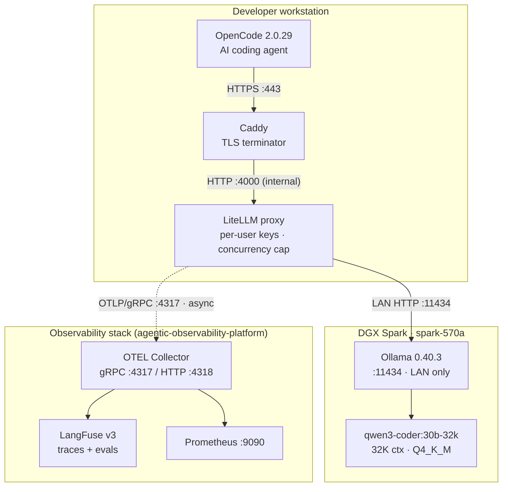

# Architecture

## Overview

OpenCode agents running on developer workstations route all model traffic through a local LiteLLM proxy rather than hitting Ollama directly. This adds per-user authentication, a concurrency cap, and observability without changing how OpenCode is used day-to-day.

Solid arrows = synchronous request path. Dashed arrow = async trace export.

## Components

### Developer workstation

| Component | Role |
|-----------|------|
| **OpenCode 2.0.29** | Agentic coding CLI. Configured in `opencode.json` to use `@ai-sdk/openai-compatible` against the local proxy. |
| **Caddy** | Terminates TLS using a locally-trusted CA cert (`tls internal`). Exposes `https://localhost`. Reverse-proxies to LiteLLM on port 4000. |
| **LiteLLM proxy** | OpenAI-compatible gateway. Issues per-user virtual API keys, enforces `max_parallel_requests`, routes to Ollama, emits OTLP spans via `success_callback: ["otel"]`. |

### DGX Spark (spark-570a)

| Component | Detail |
|-----------|--------|
| **Ollama 0.40.3** | Serves the model over HTTP on port 11434. Port is LAN-only and must never be exposed publicly. |
| **qwen3-coder:30b-32k** | Ollama modelfile alias for `qwen3-coder:30b` (Q4_K_M) with `PARAMETER num_ctx 32768` forced. Required because OpenCode's OpenAI-compat path does not pass `num_ctx` through; without the alias the context defaults to 8K. |

### Observability stack

Lives in the sibling repo `agentic-observability-platform`. LiteLLM reaches it via `host.docker.internal:4317` (Docker Desktop on Windows/Mac) or a direct host address.

| Component | Role |
|-----------|------|
| **OTEL Collector** | Receives OTLP spans from LiteLLM. Fans out: traces → LangFuse, RED metrics (via `span_metrics` connector) → Prometheus. PII fields (`user.email`, `user.ip`, `client.ssn`) are deleted by the `attributes/redaction` processor before export. |
| **LangFuse v3** | Stores and surfaces AI traces and evaluations. Receives OTLP over HTTP at `http://langfuse-web:3000/api/public/otel`. Auth via `LANGFUSE_OTEL_AUTH` env var (Basic base64). |
| **Prometheus** | Scrapes RED metrics from the OTEL Collector at `:8889`. |

## Configuration files

| File | Purpose |
|------|---------|
| `opencode.json` | OpenCode provider pointing at `https://localhost/v1`. Change `baseURL` to switch to a remote deployment. |
| `proxy/docker-compose.yaml` | Caddy + LiteLLM services. Caddy port 443 is host-bound; LiteLLM port 4000 is internal-only. |
| `proxy/Caddyfile` | `localhost { tls internal; reverse_proxy litellm:4000 }` |
| `proxy/litellm-config.yaml` | Model routing, concurrency cap, OTEL export. |
| `proxy/.env.example` | Template for `LITELLM_MASTER_KEY` and `OTEL_EXPORTER_OTLP_ENDPOINT`. |

## Switching to a remote deployment

Two values change:

| File | Key | Local | Remote |
|------|-----|-------|--------|
| `proxy/litellm-config.yaml` | `api_base` | `http://spark-570a:11434` | `http://<host>:11434` |
| `opencode.json` | `baseURL` | `https://localhost/v1` | `https://proxy.company.internal/v1` |

## Capacity notes

- Provisional concurrency cap: **2 active generations**. Measured at 2- and 4-concurrent short requests (see `PROJECT_NOTES.md`). Long-prompt and burst-workload capacity is still unmeasured.
- `qwen3-coder:30b` Q4_K_M at 32K context occupies ~31.7 GB on the Spark. The Spark has 128 GB unified memory; other workloads are bursty rather than continuously active.
- 50 registered users is a seat count, not a concurrent-request guarantee.
