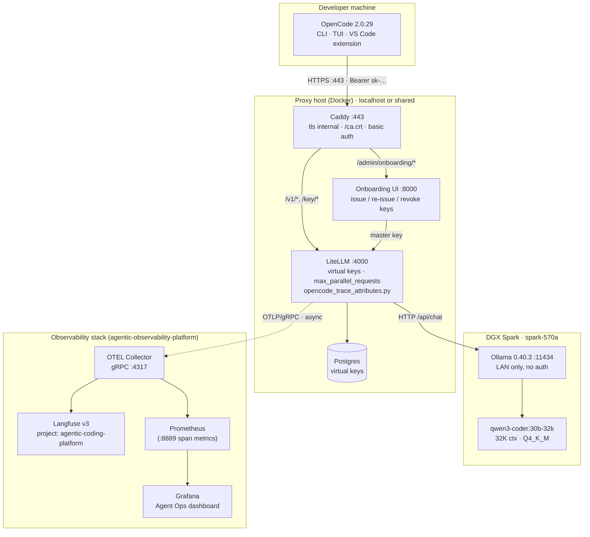
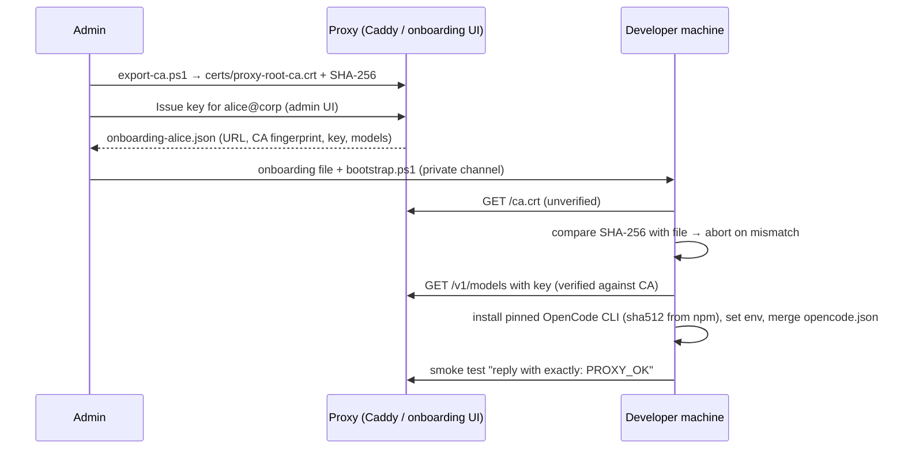

# Architecture

## Overview

OpenCode agents on developer machines send all model traffic through a proxy (Caddy → LiteLLM) instead of calling Ollama directly. The proxy adds TLS, per-developer API keys, a concurrency cap and tracing, without changing how OpenCode is used day to day.

The same proxy stack runs in two ways:

- **Per-workstation:** a developer runs the stack in Docker on their own machine and connects to `https://localhost`. Used for development and evaluation.
- **Shared:** one host runs the stack for the team. Developers need no Docker or repo. An admin issues each of them an onboarding file, and `onboarding/bootstrap.ps1` sets up their machine from it.

Solid arrows are the synchronous request path. The dashed arrow is asynchronous trace export.

## Request path

1. OpenCode calls `https://<proxy>/v1/chat/completions` through its `proxy` provider (`@ai-sdk/openai-compatible`). The key comes from `OPENCODE_PROXY_API_KEY` via `{env:…}` substitution in `opencode.json`. OpenCode trusts the proxy's certificate because `NODE_EXTRA_CA_CERTS` points at the proxy's root CA.
2. Caddy terminates TLS with a certificate from its own local CA (`tls internal`) for each name in `PROXY_SITES`, and reverse-proxies to LiteLLM.
3. LiteLLM checks the virtual key (stored hashed in Postgres) and enforces `max_parallel_requests` (2). It drops OpenAI-only parameters (`drop_params`) and calls Ollama's `/api/chat` (`ollama_chat/` provider) with `num_ctx: 32768`.
4. When the call completes, LiteLLM's `otel` callback exports spans to the collector. Before the call, the `opencode_trace_attributes.py` hook names the trace `opencode` and sets `session.id` from OpenCode's `x-opencode-session` header.

Three settings are needed for OpenCode agent turns to work at all. Each was found by a failure documented in [proxy-setup.md](proxy-setup.md#troubleshooting):

| Setting | Without it |
|---------|-----------|
| `ollama_chat/` provider prefix (not `ollama/`) | `/api/generate` forces JSON output, so every reply is parsed as a tool call and agent turns never end |
| `num_ctx: 32768` (or an Ollama alias with it) | OpenAI-compatible requests get Ollama's 8K default context |
| `drop_params: true` | Ollama rejects OpenCode's `store` parameter on every request |

## Components

### Developer machine

| Component | Role |
|-----------|------|
| **OpenCode 2.0.29** | Agentic coding CLI/TUI. The VS Code extension and OpenCode Desktop share a background service (`opencode-cli serve --service`), which keeps the environment it was started with. |
| **`opencode.json`** | `proxy` provider with `baseURL` and the model's context/output limits. In this repo it is project-local and points at `https://localhost/v1`. `bootstrap.ps1` writes the same provider into the developer's global config, with the shared proxy's URL. |
| **Environment** | `OPENCODE_PROXY_API_KEY` (virtual key) and `NODE_EXTRA_CA_CERTS` (`%USERPROFILE%\.agentic-coding\proxy-root-ca.crt`), set at user level. |

### Proxy host (`proxy/docker-compose.yaml`)

| Service | Role |
|---------|------|
| **caddy** | The only service with a host port (443). TLS for each name in `PROXY_SITES` from Caddy's local CA. `PROXY_DEFAULT_SNI` picks the certificate for clients that connect by IP and send no server name. Serves the public root at `/ca.crt` (never `root.key`). Puts `/admin/onboarding/` behind basic auth and passes the login on as `X-Admin-User`. Everything else goes to LiteLLM. |
| **litellm** | OpenAI-compatible gateway, pinned by image digest because the trace hook uses LiteLLM internals. Virtual keys, concurrency cap, routing to Ollama, OTLP export over gRPC with `tl.project=agentic-coding-platform`. |
| **postgres** | LiteLLM's database: virtual keys and their spend/limits. Data in the `postgres_data` volume. |
| **onboarding** | FastAPI admin UI ([proxy/onboarding-ui/](../proxy/onboarding-ui/)). Issues one key per email (`user_id` and `key_alias` = email, 2 parallel requests), returns the onboarding file, lists, re-issues and revokes keys. Holds the master key, which never reaches the browser. Mounts only the public CA file (`proxy/certs/`) and `onboarding/bootstrap.ps1`. |

### DGX Spark (`spark-570a`)

| Component | Detail |
|-----------|--------|
| **Ollama 0.40.3** | Serves models on port 11434 with no authentication. Keep it on the LAN, reachable only by the proxy host. |
| **qwen3-coder:30b-32k** | Ollama alias for `qwen3-coder:30b` (Q4_K_M) with `PARAMETER num_ctx 32768`. Uses about 31.7 GB at 32K context. |

When the Spark is unreachable, LiteLLM can point the same alias at Ollama on the proxy host (`host.docker.internal`). OpenCode sees no difference. See the fallback in [proxy-setup.md](proxy-setup.md), Step 6.

### Observability stack

Lives in the sibling repo `agentic-observability-platform` and is shared with other projects. LiteLLM reaches it at `host.docker.internal:4317` (Docker Desktop) or `OTEL_EXPORTER_OTLP_ENDPOINT`.

| Component | Role |
|-----------|------|
| **OTEL Collector** | Receives OTLP spans. Deletes PII attributes (`user.email`, `user.ip`, `client.ssn`) in its `attributes/redaction` processor. Routes traces on `tl.project` to that project's Langfuse exporter; unknown slugs go to the default project. The `span_metrics` connector turns spans into RED metrics on `:8889`. |
| **Langfuse v3** | Traces in the **agentic-coding-platform** project. Each OpenCode model call is a trace named `opencode`, grouped by OpenCode session ID (`ses_…`). The collector authenticates per project (`LANGFUSE_OTEL_AUTH_<SLUG>` in `otel/langfuse-projects.env`). |
| **Prometheus / Grafana** | RED metrics, filterable by the Agent Ops dashboard's **Project** variable. Token and cost panels don't cover LiteLLM; they come from the platform SDK. |

## Trust and onboarding

Each proxy has its own CA (`tls internal`), so a developer machine must trust that CA before it can make a verified connection. The fingerprint, delivered out of band, is what makes the first download of the CA safe.

Without the admin UI, the same steps are manual: `install-ca.ps1 -ProxyUrl … -Fingerprint …` and a key from `/key/generate` ([proxy-setup.md](proxy-setup.md), "Shared proxy").

## Security boundaries

| Asset | Where it lives | Exposure |
|-------|---------------|----------|
| Caddy CA private key (`root.key`) | `caddy_data` volume on the proxy host | Never served or copied. Anyone holding it can issue certificates every client trusts. Back up the volume instead. Losing the volume creates a new CA, and every client must reinstall. |
| LiteLLM master key | `proxy/.env`, the litellm and onboarding containers | Never sent to the browser or to developers |
| Virtual keys | Hashed in Postgres; plaintext only in the onboarding file and the developer's user environment | Onboarding file sent by private channel and deleted after bootstrap |
| Admin UI | Behind Caddy basic auth; no host port | Locked until `ONBOARDING_ADMIN_HASH` is set. CSRF guard: state changes must be JSON with a matching `Origin`. |
| Ollama | Spark, port 11434 | No authentication. LAN only; the proxy is the authenticated front door. |
| Trace content | Langfuse | Prompts and completions are traced. PII attributes are redacted by the collector, but code in prompts is not. |

## Testbed

[testbed/](../testbed/README.md) is the evaluation harness. It holds a small Python project (`shopcart`) and three issue-style tasks: a bug fix, a multi-file feature and a test repair. Each run gets a fresh git workspace. `check.ps1` judges it with hidden acceptance tests, protected paths and minimum test counts. It summarises the OpenCode session (steps, tool calls, tokens) and appends a row to `testbed/results/runs.jsonl`. Runs can come from the CLI or the VS Code extension and are traced in Langfuse like any other traffic.

## Repository layout

| Path | Contents |
|------|----------|
| `opencode.json` | Project-local OpenCode provider for the per-workstation proxy |
| `proxy/docker-compose.yaml` | caddy, litellm, postgres, onboarding |
| `proxy/Caddyfile` | Sites, `/ca.crt`, admin UI route and auth, LiteLLM fallback route |
| `proxy/litellm-config.yaml` | Model routing, `num_ctx`, concurrency cap, `drop_params`, callbacks |
| `proxy/opencode_trace_attributes.py` | LiteLLM hook that names OpenCode traces and sets the session |
| `proxy/.env.example` | Master key, DB password, sites/SNI, admin login, public URL, OTLP endpoint, Langfuse project |
| `proxy/onboarding-ui/` | Admin onboarding service and its tests |
| `proxy/scripts/` | `export-ca.ps1` (admin), `install-ca.ps1` (developer), shared helpers |
| `onboarding/` | `bootstrap.ps1` for developer machines, Windows Sandbox kit builder |
| `testbed/` | Evaluation project, tasks and run/check scripts |
| `baseline-probe/` | Direct Ollama concurrency probe used for the October baseline |
| `PROJECT_NOTES.md` | Feasibility goals, measurements and open questions |

## Changing deployments

| Change | Where |
|--------|-------|
| Model backend (Spark ↔ local Ollama ↔ another host) | `api_base` (and `model`) in `proxy/litellm-config.yaml`, then `docker compose restart litellm`. Clients don't change. |
| Proxy host name | `PROXY_SITES` (and `PUBLIC_PROXY_URL`) in `proxy/.env`, recreate caddy and onboarding, re-run `export-ca.ps1`. Clients need the new `baseURL`; bootstrap writes it from the onboarding file. |
| Add a model | A `model_list` entry in `litellm-config.yaml`, plus the model in clients' `opencode.json` (`provider.proxy.models`). The onboarding UI writes the model list into onboarding files. |
| Concurrency cap | `max_parallel_requests` in `litellm-config.yaml` (global), and per key (the onboarding UI's `MAX_PARALLEL_REQUESTS`, default 2) |
| Company-issued certificate | Replace `tls internal` with `tls <cert> <key>`. Developers then skip the CA step; test `NODE_EXTRA_CA_CERTS` behaviour on a clean machine first. |

## Capacity

- Provisional cap: **2 active generations**, measured with 2 and 4 concurrent short requests ([PROJECT_NOTES.md](../PROJECT_NOTES.md)). Whether requests over the cap are rejected (`429`) or queued, and how OpenCode reacts, has not been verified; the concurrent testbed runs should establish it. Long-prompt, multi-session agent and burst-workload capacity are still unmeasured.
- `qwen3-coder:30b` Q4_K_M at 32K context uses about 31.7 GB of the Spark's 128 GB unified memory. Other workloads on the Spark are bursty.
- 50 users is a seat count, not a concurrency guarantee.
